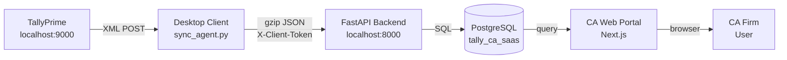

# Project Status — Tally-CA SaaS

> **Last updated:** November 2026  
> This document is a living build log. It describes what has been built, how every component currently works, and the detailed roadmap for future phases.

---

## Table of Contents

1. [System Overview](#system-overview)
2. [What's Working Right Now](#whats-working-right-now)
3. [Phase 1 — Desktop Sync Client](#phase-1--desktop-sync-client-complete)
4. [Phase 2 — Cloud Ingestion Backend](#phase-2--cloud-ingestion-backend-complete)
5. [Database Schema — Current State](#database-schema--current-state)
6. [API Reference — Live Endpoints](#api-reference--live-endpoints)
7. [Data Flow — End to End](#data-flow--end-to-end)
8. [Future Goals & Roadmap](#future-goals--roadmap)
9. [Known Limitations](#known-limitations)
10. [Environment & Dependencies](#environment--dependencies)

---

## System Overview



The platform has three independently deployable components:

| Component | Location | Role |
|-----------|----------|------|
| **Desktop Client** | Client's Windows PC | Polls TallyPrime, transforms XML → JSON, uploads to cloud |
| **Backend API** | Cloud server | Authenticates uploads, persists data, runs audit rules |
| **Web Dashboard** | Cloud server | CA firm's browser portal for dashboards and compliance |

---

## What's Working Right Now

| Capability | Status | Notes |
|-----------|--------|-------|
| Tally XML envelope generation (Ledgers, Vouchers, Stock Items) | ✅ Live | `tally_queries.py` |
| XML → flat JSON parsing | ✅ Live | Stdlib only, no deps |
| Gzip payload compression | ✅ Live | ~50% size reduction |
| Mock test harness (offline) | ✅ Live | `python tally_client.py --mock` |
| Background scheduler (every N min) | ✅ Live | APScheduler, IST timezone |
| FastAPI server with auto-reload | ✅ Live | `http://localhost:8000` |
| PostgreSQL tables auto-created on startup | ✅ Live | `Base.metadata.create_all()` |
| `X-Client-Token` authentication | ✅ Live | Looks up `clients.api_sync_token` |
| `POST /api/v1/sync/upload` ingestion endpoint | ✅ Live | Logs full payload to console |
| Interactive Swagger UI | ✅ Live | `http://localhost:8000/docs` |
| Pydantic v2 request validation | ✅ Live | `SyncUploadPayload` schema |
| Audit rules engine | 🔲 Phase 3 | Not yet built |
| Persistent voucher storage from API | 🔲 Phase 3 | Hook is in `sync.py` |
| Web dashboard | 🔲 Phase 4 | Not yet built |

---

## Phase 1 — Desktop Sync Client ✅ Complete

**Location:** `apps/desktop-client/`  
**Language:** Python 3.11+

### How it works

1. **`tally_queries.py`** — Builds TDL/XML POST envelopes for three data types:
   - Ledger masters (chart of accounts)
   - Vouchers (all transactions in a date range)
   - Stock item masters

2. **`xml_parser.py`** — Pure stdlib XML parser with three functions:
   - `parse_ledgers(xml)` → `list[dict]`
   - `parse_vouchers(xml)` → `list[dict]` (handles ISO date formatting, boolean `is_cancelled`, negative credit amounts)
   - `parse_stock_items(xml)` → `list[dict]`

3. **`tally_client.py`** — Orchestration layer:
   - POSTs XML to `http://localhost:9000`
   - Parses the response XML
   - Gzip-compresses the JSON payload (~50% savings)
   - Sends HTTPS POST to the Backend API with `X-Client-Token` header
   - Full CLI: `--mock`, `--sync ledgers|vouchers|stock_items|all`

4. **`scheduler.py`** — Wraps `tally_client.run_full_sync()` in APScheduler:
   - Fires immediately on start, then every N minutes (default: 60)
   - IST timezone (`Asia/Kolkata`)
   - `max_instances=1` prevents overlapping runs

### Mock test results

```
Ledgers:      4 records parsed   |   Compression: 55.1% savings
Vouchers:     3 records parsed   |   Compression: 52.3% savings
Stock Items:  2 records parsed   |   Compression: 45.0% savings
XML envelopes: 780 B / 1024 B / 894 B
Exit code: 0 ✅
```

---

## Phase 2 — Cloud Ingestion Backend ✅ Complete

**Location:** `apps/backend/`  
**URL:** `http://localhost:8000` (dev)  
**Framework:** FastAPI 0.111 + SQLAlchemy 2.x + PostgreSQL 18

### How it works

#### Startup sequence (`main.py`)
1. Loads settings from `.env` via Pydantic `Settings`
2. Calls `Base.metadata.create_all(engine)` — creates `cas`, `clients`, `vouchers` tables if missing
3. Mounts the sync router at `/api/v1/sync`
4. Starts serving with Uvicorn

#### Request lifecycle for `POST /api/v1/sync/upload`

```
Desktop Agent
    │
    ├─ Header: X-Client-Token: <token>
    ├─ Body:   gzip JSON payload
    │
    ▼
FastAPI Router (api/sync.py)
    │
    ├─ 1. security.py dependency:
    │      SELECT * FROM clients WHERE api_sync_token = <token>
    │      → 403 if not found, injects Client ORM object if found
    │
    ├─ 2. Pydantic validates request body against SyncUploadPayload schema
    │      → 422 if malformed
    │
    ├─ 3. Logs full payload to console (pretty-printed JSON)
    │
    └─ 4. Returns UploadResponse:
           { status, message, client_id, company_name, data_type, records_received, received_at }
```

#### File responsibilities

| File | Responsibility |
|------|---------------|
| `core/config.py` | Pydantic `Settings` — reads `.env`, validates `DATABASE_URL` prefix |
| `core/database.py` | Creates SQLAlchemy engine, `SessionLocal` factory, `get_db` dependency |
| `core/security.py` | `get_current_client` dependency — validates `X-Client-Token` header |
| `models/ca.py` | `CA` ORM model — firm name, email, one-to-many → clients |
| `models/client.py` | `Client` ORM model — company name, `ca_id` FK, `api_sync_token` |
| `models/voucher.py` | `Voucher` ORM model — GUID, date, type, number, amount, cancelled flag |
| `api/schemas.py` | Pydantic v2 `SyncUploadPayload` + `UploadResponse` |
| `api/sync.py` | `POST /api/v1/sync/upload` route handler |
| `main.py` | App factory, CORS middleware, startup hook, router registration |

---

## Database Schema — Current State

```
┌─────────────────────┐       ┌───────────────────────────┐
│         cas         │       │          clients            │
├─────────────────────┤       ├───────────────────────────┤
│ id (PK)             │◄──┐   │ id (PK)                   │
│ firm_name           │   └───│ ca_id (FK → cas.id)       │
│ email (unique)      │       │ company_name              │
│ created_at          │       │ api_sync_token (unique)   │
└─────────────────────┘       │ created_at                │
                              └───────────┬───────────────┘
                                          │
                              ┌───────────▼───────────────┐
                              │         vouchers           │
                              ├───────────────────────────┤
                              │ id (PK)                   │
                              │ client_id (FK → clients)  │
                              │ tally_guid                │
                              │ date                      │
                              │ voucher_type              │
                              │ voucher_number            │
                              │ party_ledger              │
                              │ amount (float)            │
                              │ is_cancelled (bool)       │
                              │ narration                 │
                              │ synced_at                 │
                              └───────────────────────────┘
```

> **Phase 3** will add: `ledgers`, `audit_flags` tables

---

## API Reference — Live Endpoints

### `GET /health`
Health check. No auth required.
```json
{ "status": "ok", "version": "0.2.0" }
```

### `POST /api/v1/sync/upload`
Main ingestion endpoint. Requires `X-Client-Token` header.

**Request headers:**
```
X-Client-Token: <your_client_token>
Content-Type: application/json
```

**Request body:**
```json
{
  "data_type": "vouchers",
  "record_count": 2,
  "records": [
    {
      "guid": "vch-001",
      "date": "2024-04-15",
      "voucher_type": "Payment",
      "voucher_number": "PMT/2024/001",
      "party_ledger": "Cash",
      "amount": -15000.0,
      "is_cancelled": false,
      "narration": "Office supplies"
    }
  ]
}
```

**Success response (200):**
```json
{
  "status": "success",
  "message": "Data received",
  "client_id": 1,
  "company_name": "Ravi Enterprises",
  "data_type": "vouchers",
  "records_received": 1,
  "received_at": "2026-11-07T00:09:58"
}
```

**Error responses:**
| Code | Reason |
|------|--------|
| 401 | `X-Client-Token` header missing |
| 403 | Token not found in `clients` table |
| 422 | Request body fails Pydantic validation |

---

## Data Flow — End to End

```
TallyPrime (localhost:9000)
        │
        │  XML over HTTP POST
        ▼
tally_client.py
  ├── Builds TDLXML envelope
  ├── Sends POST to localhost:9000
  ├── Receives raw XML response
  ├── Parses XML → list[dict]  (xml_parser.py)
  ├── Wraps in { data_type, record_count, records }
  ├── gzip compresses (~50% smaller)
  └── HTTPS POST → Cloud Backend
        Headers: X-Client-Token, Content-Encoding: gzip

FastAPI Backend (localhost:8000)
  ├── security.py: validates X-Client-Token → resolves Client row
  ├── Pydantic: validates + deserialises request body
  ├── Logs payload to console (Phase 2)
  ├── [HOOK] bulk_insert_vouchers() ← Phase 3 will fill this
  └── Returns UploadResponse JSON

PostgreSQL (tally_ca_saas DB)
  ├── cas          → CA firm registry
  ├── clients      → Client + token registry
  └── vouchers     → Transaction store (Phase 3)

Next.js Web Dashboard ← Phase 4
  └── Queries backend REST/GraphQL APIs → renders charts, flags
```

---

## Future Goals & Roadmap

### Phase 3 — Audit Compliance Rules Engine 🔲

**Goal:** Automatically flag suspicious or non-compliant transactions.

**Planned audit rules:**
| Rule | Regulation | Severity |
|------|-----------|----------|
| Cash payment > ₹10,000 in a single voucher | Income Tax Section 40A(3) | 🔴 Critical |
| Invalid GSTIN format in party ledger name | GST Act | 🟡 Warning |
| Transaction creates negative cash balance | Internal control | 🟡 Warning |
| Round-trip journal entries (Dr = Cr same amount, same day) | Fraud detection | 🔴 Critical |
| Backdated vouchers (> 30 days old on sync date) | Audit hygiene | 🔵 Info |

**New tables to add:**
- `ledgers` — Synced chart of accounts with running balances
- `audit_flags` — `(voucher_id, rule_name, severity, detail, created_at)`

**New API endpoints:**
- `GET /api/v1/audit/flags?client_id=&severity=` — paginated flag listing
- `POST /api/v1/sync/ledgers` — dedicated ledger ingestion

---

### Phase 4 — Next.js CA Web Dashboard 🔲

**Goal:** A beautiful, real-time portal for CA firms to manage all their clients.

**Pages to build:**

| Page | Content |
|------|---------|
| `/dashboard` (Overview) | KPI cards: total clients, active flags, last sync times |
| `/clients` | List of all onboarded companies with sync status badges |
| `/clients/[id]` | P&L snapshot, balance sheet preview, top debtors aging |
| `/compliance` | Full audit flags table — filterable by severity, rule, date |
| `/settings` | CA firm profile, client token management, notification prefs |

**Tech choices:**
- **Next.js 14** App Router + Server Components
- **TailwindCSS** + **Shadcn/ui** component library
- **Tremor Charts** for financial visualisations
- **Lucide Icons** throughout
- **React Query** for data fetching + caching

---

### Phase 5 — Production Hardening 🔲

- Alembic database migrations (versioned schema changes)
- JWT-based CA firm authentication (login / sessions)
- Rate limiting on the ingestion endpoint
- Payload deduplication via `tally_guid` upsert (no duplicate vouchers)
- Background job queue (Celery + Redis) for async audit rule processing
- Docker Compose stack (`backend` + `postgres` + `redis`)
- CI/CD pipeline (GitHub Actions)
- Deployment to a cloud provider (AWS / GCP / Railway)

---

### Phase 6 — Advanced Features 🔲

- **Email & WhatsApp alerts** when Critical audit flags are raised
- **PDF report generation** — monthly compliance summaries per client
- **Multi-company Tally** support (one desktop agent, multiple companies)
- **Historical trend charts** — 12-month P&L, cash flow waterfall
- **CA firm billing** — subscription management via Razorpay
- **Role-based access** — CA Partner, CA Manager, Client Read-Only

---

## Known Limitations

| Limitation | Impact | Fix planned in |
|-----------|--------|----------------|
| Voucher records not persisted to DB yet | Upload endpoint only logs, doesn't save | Phase 3 |
| No CA/Client admin API | Clients must be seeded via raw SQL | Phase 4 |
| No authentication for CA web portal | Dashboard has no login | Phase 5 |
| `psycopg2-binary` incompatible with Python 3.14 | Using `psycopg[binary]` v3 instead | N/A (resolved) |
| SQLAlchemy 2.0.x incompatible with Python 3.14 | Upgraded to 2.1.8 | N/A (resolved) |
| Desktop client uses `requests` (sync HTTP) | Blocks scheduler thread during large syncs | Phase 3 (switch to `httpx` async) |
| No retry/backoff on upload failure | Data lost if network drops mid-sync | Phase 3 |

---

## Environment & Dependencies

### Desktop Client (`apps/desktop-client/`)

| Package | Version | Purpose |
|---------|---------|---------|
| `requests` | 2.31 | HTTP POST to Tally + Backend |
| `apscheduler` | 3.10 | Interval-based sync scheduling |
| `python-dotenv` | 1.0.1 | Load `.env` config |
| `PySide6` | 6.7 | System tray UI *(Phase 1b)* |
| `pyinstaller` | 6.5 | Build standalone `.exe` |

### Backend (`apps/backend/`)

| Package | Version | Purpose |
|---------|---------|---------|
| `fastapi` | 0.111 | Web framework |
| `uvicorn[standard]` | 0.29 | ASGI server |
| `pydantic` | 2.x | Request/response validation |
| `pydantic-settings` | 2.x | `.env` config loading |
| `sqlalchemy` | 2.1.8 | ORM + query builder |
| `alembic` | 1.13 | DB migrations *(Phase 5)* |
| `psycopg[binary]` | 3.3 | PostgreSQL driver (Python 3.14 compatible) |
| `python-dotenv` | 1.0.1 | `.env` loader fallback |

### Runtime

| Requirement | Version |
|-------------|---------|
| Python | 3.14 (dev machine) |
| PostgreSQL | 18 |
| OS | Windows 11 |

